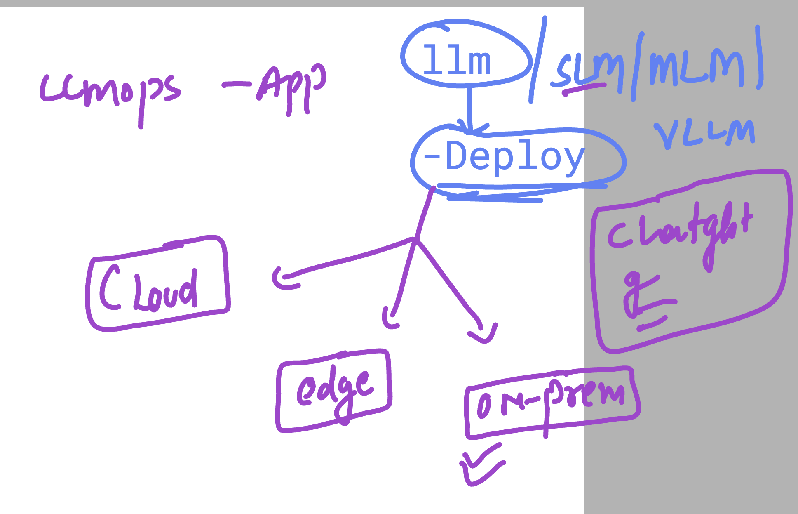
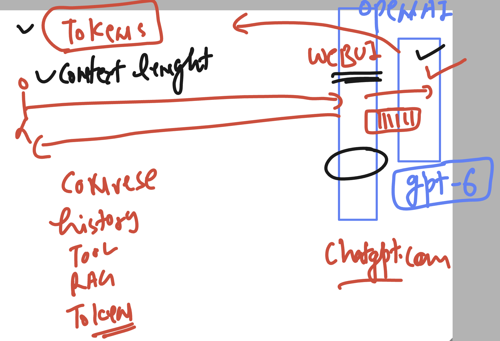
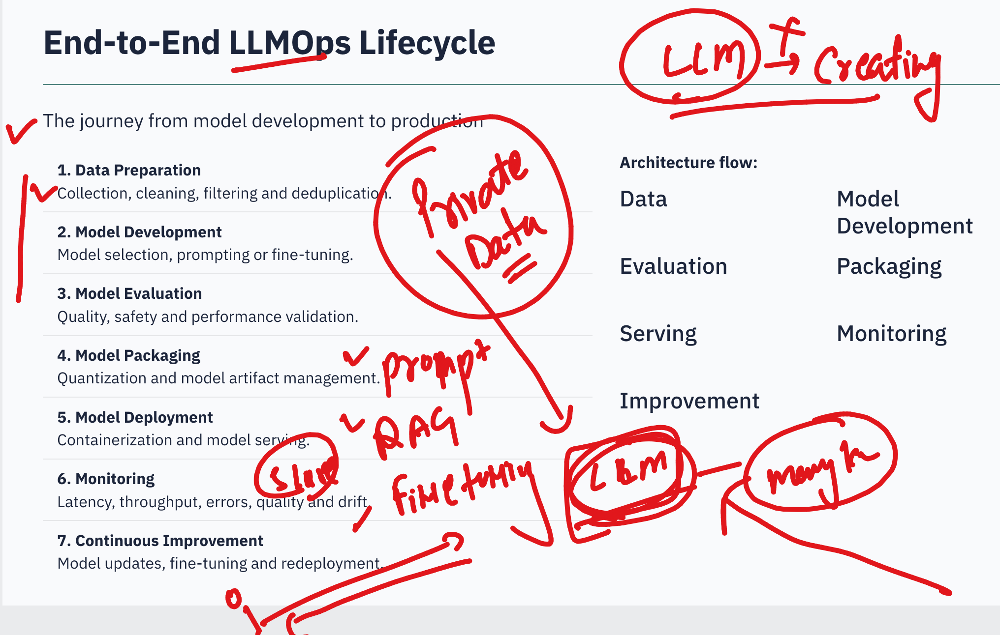
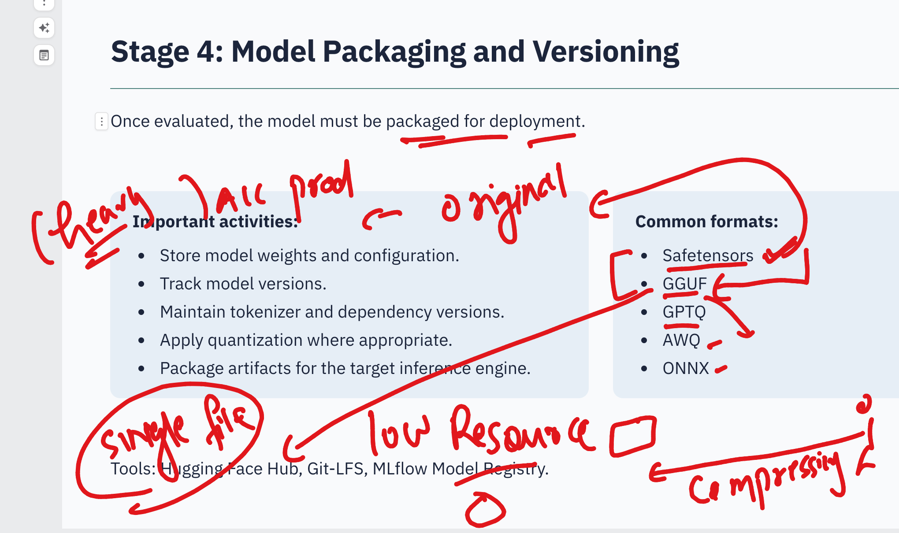

# walmart-genAI-llmops-23rdNov2026

### ML t0 LLM journey 


### LLMops for llm apps 



### MLops in history 


### LLM + prod app things to be taken care



### we are using Foundation model (given by original org like openai , meta)



### Creating virtual env in python 

```
PS C:\Users\azureuser\Desktop\llmops-demo> python -m venv ashu-env
PS C:\Users\azureuser\Desktop\llmops-demo> .\ashu-env\Scripts\activate 
(ashu-env) PS C:\Users\azureuser\Desktop\llmops-demo>  


```
### Installing some testing libs 

```
pip install torch --index-url https://download.pytorch.org/whl/cpu


===> Installing more libs

pip install transformers datasets peft accelerate safetensors sentencepiece huggingface_hub scikit-learn
```

### Model package format to deployment 



### download hugging face model locally 

```
 hf download  HuggingFaceTB/SmolLM2-135M --local-dir .\models\

 ```

 ### Downloading ollama & verify 

 ```

PS C:\Users\azureuser> ollama --version
ollama version is 0.40.17
PS C:\Users\azureuser> ollama list
NAME    ID    SIZE    MODIFIED
PS C:\Users\azureuser>

```