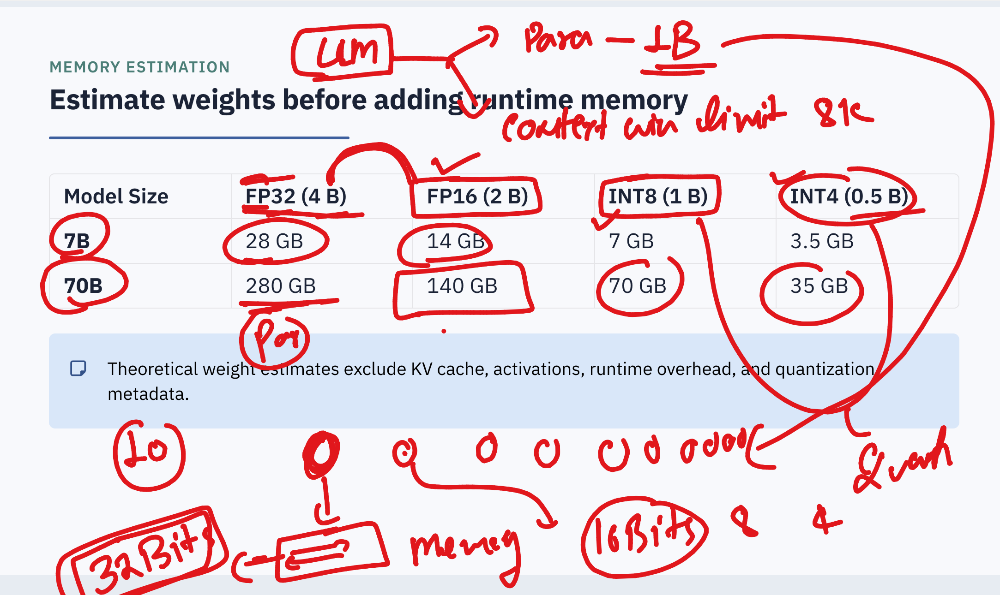
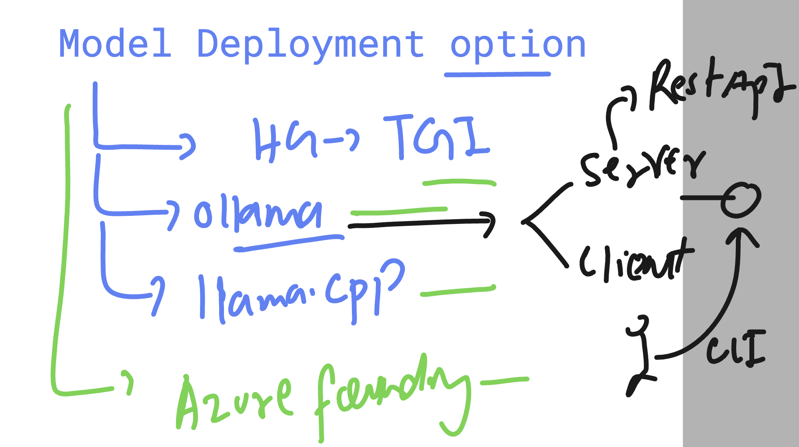
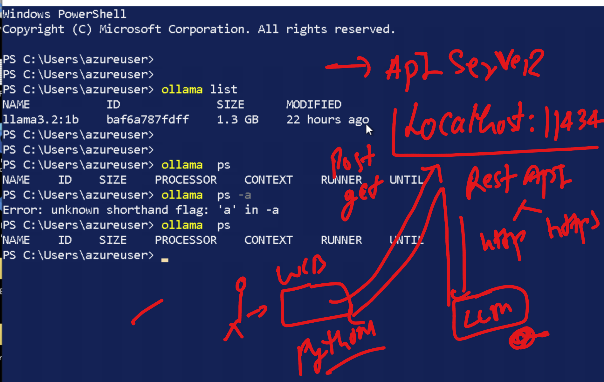
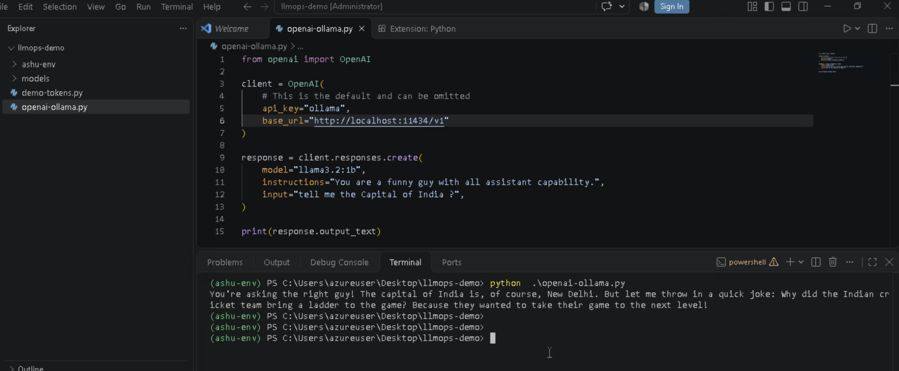

# walmart-genAI-llmops-23rdNov2026

### GPU understanding for LLM

### LLM model sizing understanding 

### Model Deployment options 

### Ollama rest API

### calling openai std for ollama loaded model 

