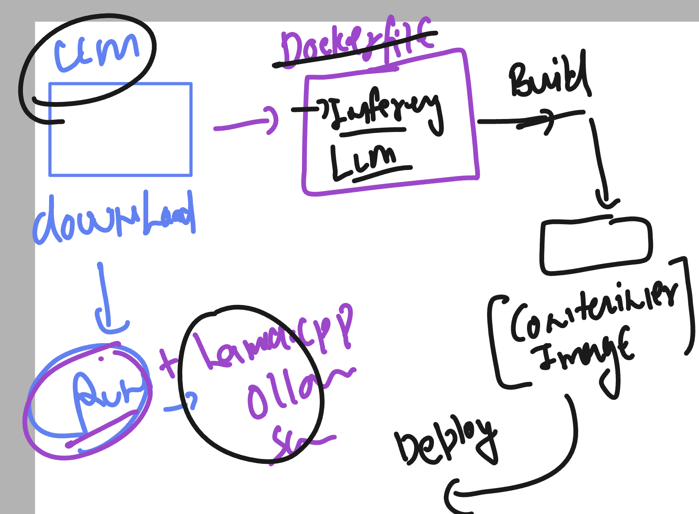
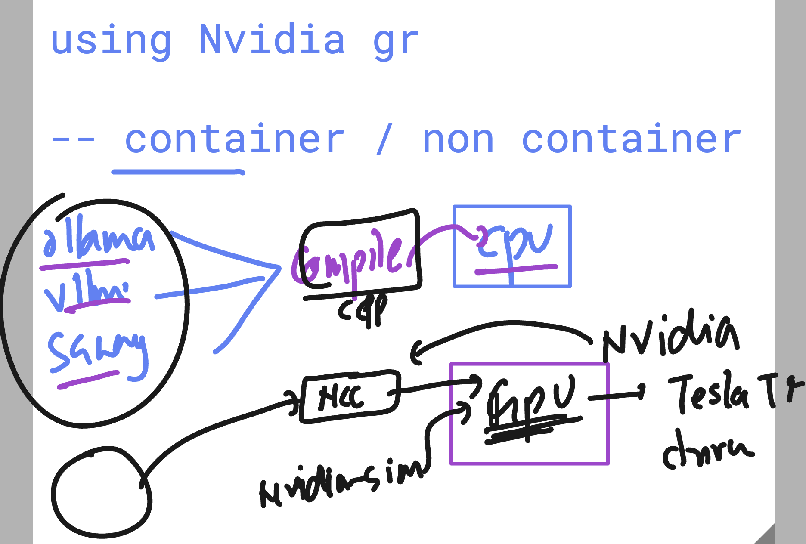

# walmart-genAI-llmops-23rdNov2026

### Revision 1


### Reunderstanding RAG process


### steps to perform in Ubunt vm 

```
ssh  azureuser@48.214.147.119

azureuser@48.214.147.119's password: 
Welcome to Ubuntu 24.04.5 LTS (GNU/Linux 7.0.0-1020-azure x86_64)


===>
sudo apt update

=== cpu details and vendor

azureuser@ashumodle-container:~$ lscpu 
Architecture:                x86_64
  CPU op-mode(s):            32-bit, 64-bit
  Address sizes:             48 bits physical, 48 bits virtual
  Byte Order:                Little Endian
CPU(s):                      2
  On-line CPU(s) list:       0,1
Vendor ID:                   AuthenticAMD
  Model name:                AMD EPYC 7763 64-Core Processor
    CPU family:              25
    Model:                   1
    Thread(s) per core:      2
    Core(s) per socket:      1
    Socket(s):               1
    Stepping:                1
    BogoMIPS:                4890.86


===> Installing docker 

# Add Docker's official GPG key:
sudo apt update
sudo apt install ca-certificates curl
sudo install -m 0755 -d /etc/apt/keyrings
sudo curl -fsSL https://download.docker.com/linux/ubuntu/gpg -o /etc/apt/keyrings/docker.asc
sudo chmod a+r /etc/apt/keyrings/docker.asc

# Add the repository to Apt sources:
sudo tee /etc/apt/sources.list.d/docker.sources <<EOF
Types: deb
URIs: https://download.docker.com/linux/ubuntu
Suites: $(. /etc/os-release && echo "${UBUNTU_CODENAME:-$VERSION_CODENAME}")
Components: stable
Architectures: $(dpkg --print-architecture)
Signed-By: /etc/apt/keyrings/docker.asc
EOF

sudo apt update

===>
sudo apt install docker-ce docker-ce-cli containerd.io docker-buildx-plugin docker-compose-plugin

```
### verify installation 

```
zureuser@ashumodle-container:~$ sudo docker --version 
Docker version 29.10.0, build fdd4b8e
azureuser@ashumodle-container:~$ 
azureuser@ashumodle-container:~$ sudo docker version 
Client: Docker Engine - Community
 Version:           29.10.0
 API version:       1.57
 Go version:        go1.27.4
 Git commit:        fdd4b8e
 Built:             Mon Nov 16 11:00:49 2026
 OS/Arch:           linux/amd64
 Context:           default

Server: Docker Engine - Community
 Engine:
  Version:          29.10.0
  API version:      1.57 (minimum version 1.40)
  Go version:       go1.27.4
  Git commit:       06db173
  Built:            Mon Nov 16 11:01:38 2026
  OS/Arch:          linux/amd64
  Experimental:     false
 containerd:
  Version:          v2.4.2
  GitCommit:        b7a25261e029d68978bbf290df0a62fc819b3c51
 runc:
  Version:          1.5.3

```

### Understanding LLM  containerization 



### Installing software 

```
 sudo apt install python3-venv python3-pip 


  pip install openai numpy huggingface_hub
```

### downloading gguf quantized model

```
ls models-llm/
(llm-ops-env) azureuser@ashumodle-container:~$ 
(llm-ops-env) azureuser@ashumodle-container:~$ 
(llm-ops-env) azureuser@ashumodle-container:~$  hf download unsloth/SmolLM2-360M-Instruct-GGUF   SmolLM2-360M-Instruct-Q4_K_M.gguf   --local-dir ./models-llm/
Warning: You are sending unauthenticated requests to the HF Hub. Please set a HF_TOKEN to enable higher rate limits and faster downloads.
SmolLM2-360M-Instruct-Q4_K_M.gguf: downloading bytes: █████████████████████████████████████████████████████████████████|  270MB, 23.9MB/s  
SmolLM2-360M-Instruct-Q4_K_M.gguf: reconstructing file: 100%|█████████████████████████████████████████████████|  271MB /  271MB, 24.8MB/s  
✓ Downloaded
  path: /home/azureuser/models-llm/SmolLM2-360M-Instruct-Q4_K_M.gguf
(llm-ops-env) azureuser@ashumodle-container:~$ ls models-llm/
SmolLM2-360M-Instruct-Q4_K_M.gguf
(llm-ops-env) azureuser@ashumodle-container:~$ ls -lh models-llm/
total 259M
-rw-rw-r-- 1 azureuser azureuser 259M Nov 25 05:34 SmolLM2-360M-Instruct-Q4_K_M.gguf
(llm-ops-env) azureuser@ashumodle-container:~$ 


```

### Dockerifle + gguf model 

```
m-ops-env) azureuser@ashumodle-container:~$ ls
Dockerfile  flask-llm-chat.zip  llm-ops-env  models-llm
(llm-ops-env) azureuser@ashumodle-container:~$ ls models-llm/
SmolLM2-360M-Instruct-Q4_K_M.gguf
(llm-ops-env) azureuser@ashumodle-container:~$ cat Dockerfile 
FROM  ghcr.io/ggml-org/llama.cpp:server

COPY  models-llm/SmolLM2-360M-Instruct-Q4_K_M.gguf /models/model.gguf 

EXPOES 8080

CMD ["-m","/models/model.gguf","--host","0.0.0.0","--port","8080","-c","2048","-t","4"] 
(llm-ops-env) azureuser@ashumodle-container:~$ ls
Dockerfile  flask-llm-chat.zip  llm-ops-env  models-llm
(llm-ops-env) azureuser@ashumodle-container:~$ 


====>
 sudo docker build -t ashu-walmart:llamacppv1 . 
[+] Building 17.3s (7/7) FINISHED                                                                                            docker:default
 => [internal] load build definition from Dockerfile                                                                                   0.0s
 => => transferring dockerfile: 254B                                                                                                   0.0s
 => [internal] load metadata for ghcr.io/ggml-org/llama.cpp:server                                                                     0.4s
 => [internal] load .dockerignore                                                                                                      0.0s
 => => transferring context: 2B                                                                                                        0.0s
 => [internal] load build context                            


 ===>

  sudo docker images
                                                                                                                        i Info →   U  In Use
IMAGE                                                 ID             DISK USAGE   CONTENT SIZE   EXTRA
ashu-walmart:llamacppv1                               9f1e58345c3d        1.7GB          562MB        
dockerashu/small-flask:appv2                          daaf5f1d506c        189MB           46MB    U   
dockerashu/smollm-cpu:1.0                             360c9e814f91        1.7GB          562MB    U   
```

### deploy containerized llm 

```
 
(llm-ops-env) azureuser@ashumodle-container:~$ sudo docker  run -itd --name ashullm-new -p 8082:8080  ashu-walmart:llamacppv1
21f64cac9d7932baa738d2c1c3f1a5c0c16bfc4f8282bae6d2269e1378e4585c
(llm-ops-env) azureuser@ashumodle-container:~$ sudo docker ps
CONTAINER ID   IMAGE                     COMMAND                  CREATED         STATUS                            PORTS                                         NAMES
21f64cac9d79   ashu-walmart:llamacppv1   "/app/llama-server -…"   3 seconds ago   Up 3 seconds (health: starting)   0.0.0.0:8082->8080/tcp, [::]:8082->8080/tcp   ashullm-new
(llm-ops-env) azureuser@ashumodle-container:~$ 
(llm-ops-env) azureuser@ashumodle-container:~$ 


```


### LLM inferencing to model cpu / gpu calling 



### using SGlang to deply with Nvidia Gpu 

```
 docker run --rm --gpus all   --ipc=host   -p 30000:30000   lmsysorg/sglang:latest   sglang serve Qwen/Qwen3-0.6B   --host 0.0.0.0   --port 30000

```

### testing inferning 

```
curl http://localhost:30000/v1/chat/completions   -H "Content-Type: application/json"   -d '{
    "model": "SmolLM2-360M-Instruct",
    "messages": [
      {"role": "user", "content": "Explain Docker"}
    ],
    "max_tokens": 100
  }'

```