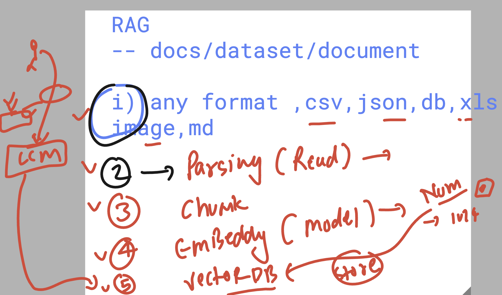

# walmart-genAI-llmops-23rdNov2026

### Revision 1


### Reunderstanding RAG process



### steps to perform in Ubunt vm 

```
ssh  azureuser@48.214.147.119

azureuser@48.214.147.119's password: 
Welcome to Ubuntu 24.04.5 LTS (GNU/Linux 7.0.0-1020-azure x86_64)


===>
sudo apt update

=== cpu details and vendor

azureuser@ashumodle-container:~$ lscpu 
Architecture:                x86_64
  CPU op-mode(s):            32-bit, 64-bit
  Address sizes:             48 bits physical, 48 bits virtual
  Byte Order:                Little Endian
CPU(s):                      2
  On-line CPU(s) list:       0,1
Vendor ID:                   AuthenticAMD
  Model name:                AMD EPYC 7763 64-Core Processor
    CPU family:              25
    Model:                   1
    Thread(s) per core:      2
    Core(s) per socket:      1
    Socket(s):               1
    Stepping:                1
    BogoMIPS:                4890.86


===> Installing docker 

# Add Docker's official GPG key:
sudo apt update
sudo apt install ca-certificates curl
sudo install -m 0755 -d /etc/apt/keyrings
sudo curl -fsSL https://download.docker.com/linux/ubuntu/gpg -o /etc/apt/keyrings/docker.asc
sudo chmod a+r /etc/apt/keyrings/docker.asc

# Add the repository to Apt sources:
sudo tee /etc/apt/sources.list.d/docker.sources <<EOF
Types: deb
URIs: https://download.docker.com/linux/ubuntu
Suites: $(. /etc/os-release && echo "${UBUNTU_CODENAME:-$VERSION_CODENAME}")
Components: stable
Architectures: $(dpkg --print-architecture)
Signed-By: /etc/apt/keyrings/docker.asc
EOF

sudo apt update

===>
sudo apt install docker-ce docker-ce-cli containerd.io docker-buildx-plugin docker-compose-plugin

```
### verify installation 

```
zureuser@ashumodle-container:~$ sudo docker --version 
Docker version 29.10.0, build fdd4b8e
azureuser@ashumodle-container:~$ 
azureuser@ashumodle-container:~$ sudo docker version 
Client: Docker Engine - Community
 Version:           29.10.0
 API version:       1.57
 Go version:        go1.27.4
 Git commit:        fdd4b8e
 Built:             Mon Nov 16 11:00:49 2026
 OS/Arch:           linux/amd64
 Context:           default

Server: Docker Engine - Community
 Engine:
  Version:          29.10.0
  API version:      1.57 (minimum version 1.40)
  Go version:       go1.27.4
  Git commit:       06db173
  Built:            Mon Nov 16 11:01:38 2026
  OS/Arch:          linux/amd64
  Experimental:     false
 containerd:
  Version:          v2.4.2
  GitCommit:        b7a25261e029d68978bbf290df0a62fc819b3c51
 runc:
  Version:          1.5.3

```

### Understanding LLM  containerization 


### Installing software 

```
 sudo apt install python3-venv python3-pip 


  pip install openai numpy huggingface_hub
```
