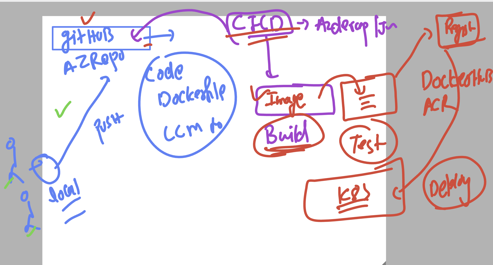
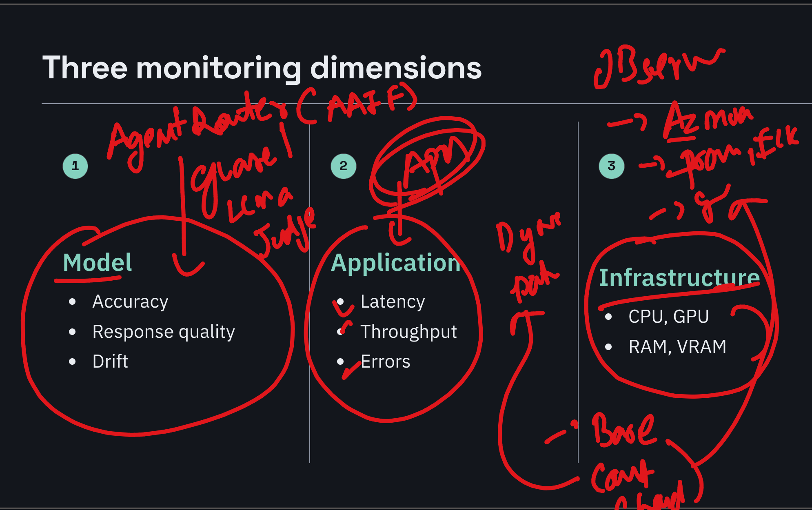
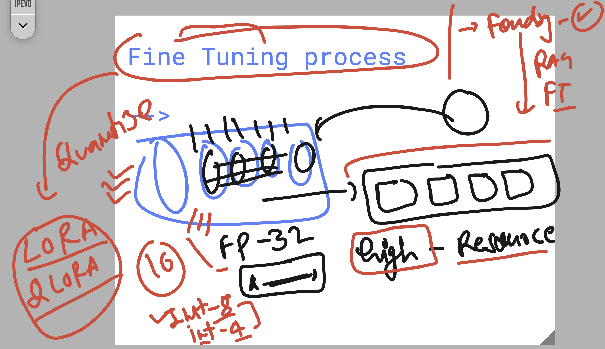
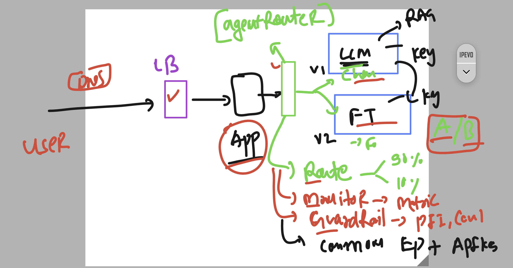
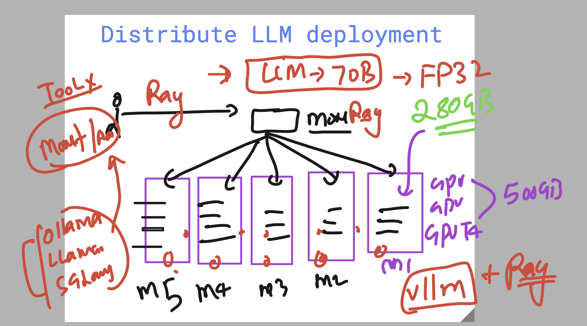

# walmart-genAI-llmops-23rdNov2026

### cicd for llm powered app deployment in k8s 



### pushing image to docker hub so that we can deploy on k8s

```
ureuser@ashumodle-container:~$ sudo docker images
                                                                                                                        i Info →   U  In Use
IMAGE                                                 ID             DISK USAGE   CONTENT SIZE   EXTRA
ashu-walmart:llamacppv1                               9f1e58345c3d        1.7GB          562MB    U   
dockerashu/small-flask:appv2                          daaf5f1d506c        189MB           46MB    U   
dockerashu/smollm-cpu:1.0                             360c9e814f91        1.7GB          562MB    U   
ghcr.io/huggingface/text-generation-inference:3.3.7   c01c6b7c3087       26.7GB         9.25GB        
lmsysorg/sglang:v0.5.23-xeon                          f22c18d17527       7.96GB          2.1GB        
qdrant/qdrant:latest                                  d277592721d2        287MB         78.7MB    U   
small-flask:appv1                                     4b07bcec70f2        189MB           46MB        
small-flask:appv2                                     daaf5f1d506c        189MB           46MB    U   
smollm-cpu:1.0                                        360c9e814f91        1.7GB          562MB    U   
walmart-smoll-llm:lamma-cpp-v1                        456886fdc28a        1.7GB          562MB    U   
azureuser@ashumodle-container:~$ sudo docker  tag  ashu-walmart:llamacppv1   dockerashu/ashu-walmart:llamacppv1
azureuser@ashumodle-container:~$ sudo docker login -u dockerashu

i Info → A Personal Access Token (PAT) can be used instead.
         To create a PAT, visit https://app.docker.com/settings
         
         
Password: 
Login Succeeded
azureuser@ashumodle-container:~$ sudo docker push  dockerashu/ashu-walmart:llamacppv1
The push refers to repository [docker.io/dockerashu/ashu-walmart]
96aae9022e0e: Mounted from dockerashu/smollm-cpu 
340c6376a26a: Pushed 
517b871c26ea: Mounted from dockerashu/smollm-cpu 
44136fa355b3: Mounted from dockerashu/smollm-cpu 
9ff74591318f: Mounted from dockerashu/smollm-cpu 


```


## LLM apps monitoring pillers




### Custom mertrics mon for LLMs


### Implementing custom metrics 

```
azureuser@ashumodle-container:~$ sudo  docker images
                                                                                                                        i Info →   U  In Use
IMAGE                                                 ID             DISK USAGE   CONTENT SIZE   EXTRA
ashu-walmart:llamacppv1                               9f1e58345c3d        1.7GB          562MB    U   
dockerashu/ashu-walmart:llamacppv1                    9f1e58345c3d        1.7GB          562MB    U   
dockerashu/small-flask:appv2                          daaf5f1d506c        189MB           46MB    U   
dockerashu/smollm-cpu:1.0                             360c9e814f91        1.7GB          562MB    U   
ghcr.io/huggingface/text-generation-inference:3.3.7   c01c6b7c3087       26.7GB         9.25GB        
lmsysorg/sglang:v0.5.23-xeon                          f22c18d17527       7.96GB          2.1GB        
qdrant/qdrant:latest                                  d277592721d2        287MB         78.7MB    U   
small-flask:appv1                                     4b07bcec70f2        189MB           46MB        
small-flask:appv2                                     daaf5f1d506c        189MB           46MB    U   
smollm-cpu:1.0                                        360c9e814f91        1.7GB          562MB    U   
walmart-smoll-llm:lamma-cpp-v1                        456886fdc28a        1.7GB          562MB    U   
azureuser@ashumodle-container:~$ sudo docker  ps 
CONTAINER ID   IMAGE     COMMAND   CREATED   STATUS    PORTS     NAMES
azureuser@ashumodle-container:~$ 


```

### creating vector instance 

```
 docker run -d   --name qdrant-demo   -p 6333:6333   -p 6334:6334   -v qdrant_storage:/qdrant/storage   qdrant/qdrant

```
### using sample data 

```
 cat documents/sample_docs.json 

[
  {
    "id": 1,
    "title": "Kubernetes Pod",
    "category": "Kubernetes",
    "content": "A Kubernetes Pod is the smallest deployable unit in Kubernetes. It can contain one or more containers. Pods are managed by Kubernetes controllers such as Deployments."
  },
  {
    "id": 2,
    "title": "Docker Container",
    "category": "Docker",
    "content": "Docker containers package applications and their dependencies into isolated environments. Docker images are used to create containers, making application deployment consistent across environments."
  },
  {
    "id": 3,
    "title": "Linux Troubleshooting",
    "category": "Linux",
    "content": "Linux administrators use commands such as top, free, df, ps, and journalctl to troubleshoot CPU, memory, disk, process, and system log issues."
  },
  {
    "id": 4,
    "title": "CI/CD Pipeline",
    "category": "DevOps",
    "content": "A CI/CD pipeline automates application building, testing, and deployment. Tools such as Jenkins and GitHub Actions help teams deliver software continuously."
  },
  {
    "id": 5,
    "title": "Kubernetes Scaling",
    "category": "Kubernetes",
    "content": "Kubernetes Horizontal Pod Autoscaler automatically adjusts the number of application Pod replicas based on observed metrics such as CPU and memory utilization."
  }
]

(llmops-env) root@ashumodle-container:~/LLMOps-Lab/qdrant-demo# 

```


## Understanding some basic about fine tuning 




### LLM apps with prod env basic overview 



### vllm + Ray 



### deploy LLM + llm app in k8s 

```
mops-308-trainer [ ~ ]$ kubectl  create  deployment  ashu-llm-smoll --image  dockerashu/smollm-cpu:1.0 --port 8080 --replicas 1
deployment.apps/ashu-llm-smoll created
llmops-308-trainer [ ~ ]$ kubectl get deploy
NAME             READY   UP-TO-DATE   AVAILABLE   AGE
ashu-llm-smoll   0/1     1            0           5s
llmops-308-trainer [ ~ ]$ kubectl get  pods
NAME                              READY   STATUS              RESTARTS   AGE
ashu-llm-smoll-6976c46fb7-6mz2x   0/1     ContainerCreating   0          9s
llmops-308-trainer [ ~ ]$ kubectl get hpa
No resources found in default namespace.
llmops-308-trainer [ ~ ]$ kubectl get  pods
NAME                              READY   STATUS    RESTARTS   AGE
ashu-llm-smoll-6976c46fb7-6mz2x   1/1     Running   0          24s
llmops-308-trainer [ ~ ]$ 


===>

 1  az account set --subscription 452f5ddd-eb48-4353-a961-30bec8a7f603
    2  az aks get-credentials --resource-group Budget-RG --name llm-k8s --overwrite-existing
    3  kubectl version 
    4  kubectl get nodes
    5  kubectl get ns
    6  kubectl get  all
    7  kubectl  create  deployment  ashu-llm-smoll --image  dockerashu/smollm-cpu:1.0 --port 8080 --replicas 1
    8  kubectl get deploy
    9  kubectl get  pods
   10  kubectl get hpa
   11  kubectl get  pods
   12  kubectl logs ashu-llm-smoll-6976c46fb7-6mz2x
   13  kubectl get deploy
   14  kubectl expose deploy ashu-llm-smoll  --type ClusterIP --port 8080 --name llm-endpoint 
   15  kubectl get svc
   16  kubectl get po
   17  kubectl get deploy
   18  kubectl get ep llm-endpoint
   19  kubectl scale deployment ashu-llm-smoll --replicas 2
   20  kubectl get deploy
   21  kubectl get po
   22  kubectl get ep llm-endpoint
   23  history 
   24  kubectl  create  deployment ashu-llm-app --image dockerashu/small-flask:appv2  --port 5000 --replicas 1
   25  kubectl get deploy
   26  kubectl get  po
   27  kubectl expose deploy ashu-llm-app --type LoadBalancer --port 80 --target-port 5000
   28  kubectl get svc
   29  kubectl get ep ashu-llm-app
   30  kubectl get hpa
   31  kubectl top pods
   32  history 

```