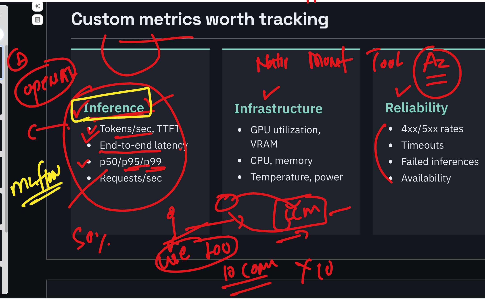

# walmart-genAI-llmops-23rdNov2026

### cicd for llm powered app deployment in k8s 


### pushing image to docker hub so that we can deploy on k8s

```
ureuser@ashumodle-container:~$ sudo docker images
                                                                                                                        i Info →   U  In Use
IMAGE                                                 ID             DISK USAGE   CONTENT SIZE   EXTRA
ashu-walmart:llamacppv1                               9f1e58345c3d        1.7GB          562MB    U   
dockerashu/small-flask:appv2                          daaf5f1d506c        189MB           46MB    U   
dockerashu/smollm-cpu:1.0                             360c9e814f91        1.7GB          562MB    U   
ghcr.io/huggingface/text-generation-inference:3.3.7   c01c6b7c3087       26.7GB         9.25GB        
lmsysorg/sglang:v0.5.23-xeon                          f22c18d17527       7.96GB          2.1GB        
qdrant/qdrant:latest                                  d277592721d2        287MB         78.7MB    U   
small-flask:appv1                                     4b07bcec70f2        189MB           46MB        
small-flask:appv2                                     daaf5f1d506c        189MB           46MB    U   
smollm-cpu:1.0                                        360c9e814f91        1.7GB          562MB    U   
walmart-smoll-llm:lamma-cpp-v1                        456886fdc28a        1.7GB          562MB    U   
azureuser@ashumodle-container:~$ sudo docker  tag  ashu-walmart:llamacppv1   dockerashu/ashu-walmart:llamacppv1
azureuser@ashumodle-container:~$ sudo docker login -u dockerashu

i Info → A Personal Access Token (PAT) can be used instead.
         To create a PAT, visit https://app.docker.com/settings
         
         
Password: 
Login Succeeded
azureuser@ashumodle-container:~$ sudo docker push  dockerashu/ashu-walmart:llamacppv1
The push refers to repository [docker.io/dockerashu/ashu-walmart]
96aae9022e0e: Mounted from dockerashu/smollm-cpu 
340c6376a26a: Pushed 
517b871c26ea: Mounted from dockerashu/smollm-cpu 
44136fa355b3: Mounted from dockerashu/smollm-cpu 
9ff74591318f: Mounted from dockerashu/smollm-cpu 


```


## LLM apps monitoring pillers


### Custom mertrics mon for LLMs



### Implementing custom metrics 

```
azureuser@ashumodle-container:~$ sudo  docker images
                                                                                                                        i Info →   U  In Use
IMAGE                                                 ID             DISK USAGE   CONTENT SIZE   EXTRA
ashu-walmart:llamacppv1                               9f1e58345c3d        1.7GB          562MB    U   
dockerashu/ashu-walmart:llamacppv1                    9f1e58345c3d        1.7GB          562MB    U   
dockerashu/small-flask:appv2                          daaf5f1d506c        189MB           46MB    U   
dockerashu/smollm-cpu:1.0                             360c9e814f91        1.7GB          562MB    U   
ghcr.io/huggingface/text-generation-inference:3.3.7   c01c6b7c3087       26.7GB         9.25GB        
lmsysorg/sglang:v0.5.23-xeon                          f22c18d17527       7.96GB          2.1GB        
qdrant/qdrant:latest                                  d277592721d2        287MB         78.7MB    U   
small-flask:appv1                                     4b07bcec70f2        189MB           46MB        
small-flask:appv2                                     daaf5f1d506c        189MB           46MB    U   
smollm-cpu:1.0                                        360c9e814f91        1.7GB          562MB    U   
walmart-smoll-llm:lamma-cpp-v1                        456886fdc28a        1.7GB          562MB    U   
azureuser@ashumodle-container:~$ sudo docker  ps 
CONTAINER ID   IMAGE     COMMAND   CREATED   STATUS    PORTS     NAMES
azureuser@ashumodle-container:~$ 


```
